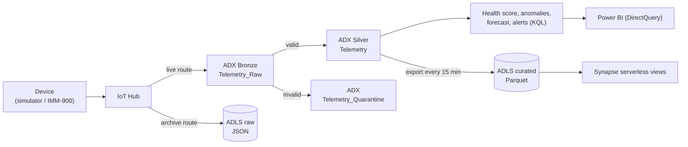

# Husky IoT Predictive Maintenance (Azure)

An Azure data platform for industrial machine telemetry. It takes device readings through IoT Hub, validates them in Azure Data Explorer, scores machine health and maintenance priority in near real time, archives everything to a data lake, and serves history through Synapse serverless SQL and Power BI.

The infrastructure is defined in Terraform. Two separate GitHub Actions pipelines deploy infrastructure and application code, both authenticating with OIDC. Every application release proves itself end to end: it sends a real test message and checks every layer.

> **Scope:** this is a learning and portfolio project with one fully built **Dev** environment. Test and Prod aren't implemented; see [Status](#status). No performance figures are claimed beyond the single-run timings recorded in [docs/testing.md](docs/testing.md).

## Architecture



| Layer | Service | Details |
|---|---|---|
| Ingest | Azure IoT Hub (F1) | every message goes to both ADX and the raw archive |
| Real time | Azure Data Explorer (Dev SKU) | Bronze, then Silver or Quarantine through update policies; 12 validation rules |
| Analytics | KQL functions | health score, vibration anomalies, trend forecast, prioritised maintenance alerts |
| Lake | ADLS Gen2 | `raw` (JSON replay copy), `curated` (Parquet) |
| History | Synapse serverless SQL | deduplicated, daily and fleet views over Parquet |
| Report | Power BI | live report on ADX |
| Operate | Azure Monitor | ingestion and export failure alerts by email |

More detail: [architecture](docs/architecture.md) · [data flow](docs/data-flow.md)

## How it's delivered

| Pipeline | What it does |
|---|---|
| [Terraform no-change gate](.github/workflows/deploy-dev.yml) | fails if Azure doesn't match the code (drift detection) |
| [Approved Terraform deployment](.github/workflows/deploy-dev-approved.yml) | saved plan → delete/replace guard → SHA-256 → required reviewer → apply the exact plan from the same commit |
| [Application release](.github/workflows/deploy-app-dev.yml) | deploy KQL and Synapse SQL, **re-run to prove nothing changes**, verify objects, then send a test message and trace it through every layer |

- Terraform state lives in Azure Storage with Entra-only access, versioning and soft delete.
- The pipeline identity has `Contributor` on one resource group, plus narrowly scoped data rights.
- Grants that widen its data access are made by an administrator and recorded in Git.

More detail: [CI/CD](docs/cicd.md) · [security](docs/security.md)

## Verified results

| Evidence | Result |
|---|---|
| Run `41313214638`: full release, 2026-11-01 | 40 unit tests and **13 integration tests passed**. Test message `08600bc9-…` reached Bronze/Silver, the raw archive, Parquet and Synapse; an invalid reading was quarantined. |
| Run `41310902846`: KQL + SQL release | Synapse views deployed twice with identical results by the least-privilege deployer; `2 passed` |
| Run `41287480751`: approved Terraform apply | `dev.tfplan: OK`, 1 added, 0 changed, 0 destroyed |
| Run `41287867245`: no-change gate after that apply | "No changes" |
| Negative controls | a broken KQL function and a broken SQL view both failed their deploys; a missing view failed its test |

Full table and the controls that were *not* exercised: [docs/testing.md](docs/testing.md) · [docs/cicd.md](docs/cicd.md#verified-runs)

## Status

| Area | Status |
|---|---|
| Simulator, contract, IoT Hub, ADX medallion, analytics, export, Synapse, Power BI, monitoring | ✅ Dev |
| Terraform remote state, OIDC, no-change gate, approved-plan deployment | ✅ Dev |
| Application release with end-to-end integration tests (Lessons 19A–19C) | ✅ Dev, proven |
| Data-health gates: freshness and reconciliation (Lesson 19D) | ⏭ skipped; draft test kept uncommitted |
| Test and Prod environments, promotion, rollback | ⬜ not started |
| Failure and recovery drills | ⬜ planned next |
| Security hardening (network isolation, key-less ADX connection, manual principals into Terraform) | ⬜ not started; see [known gaps](docs/security.md#known-gaps) |

## Repository layout

```
contracts/       telemetry JSON schema (v1)
simulator/       machine and fault simulation, IoT Hub sender
kql/             ADX tables, validation, update policies, analytics, export
synapse/         serverless SQL: one-time bootstrap (00-02) and release views (05)
deploy/          release manifests (order and create-only rules)
scripts/         deploy_kql.py, deploy_synapse.py
infra/bootstrap  Terraform remote-state storage (run once, local state)
infra/terraform/envs/dev   Dev infrastructure
infra/manual-grants.md     admin-only grants, recorded
tests/           unit tests; tests/integration runs against live Azure
powerbi/         live report (.pbix)
docs/            architecture, data flow, CI/CD, security, testing, runbooks
```

## Running it

**Offline (no Azure):**
```powershell
python -m venv .venv; .venv\Scripts\Activate.ps1
pip install azure-identity azure-kusto-data azure-storage-blob azure-iot-device jsonschema pyodbc pytest
python -m pytest tests -q                    # 40 passed
python scripts\deploy_kql.py --dry-run       # needs $env:ADLS_ACCOUNT_NAME
python scripts\deploy_synapse.py --dry-run
```

**Releasing to Dev:**
```powershell
az kusto cluster start --name adxhuskypdmdev0599 --resource-group rg-husky-pdm-dev
gh workflow run deploy-app-dev.yml -f scope=full      # or kql-only / kql-sql
gh run watch
az kusto cluster stop  --name adxhuskypdmdev0599 --resource-group rg-husky-pdm-dev
```

**Cost:** the ADX cluster is the main running cost. Stop it after every session. IoT Hub F1 allows 8,000 messages per day.

When something breaks: [docs/runbooks.md](docs/runbooks.md).
