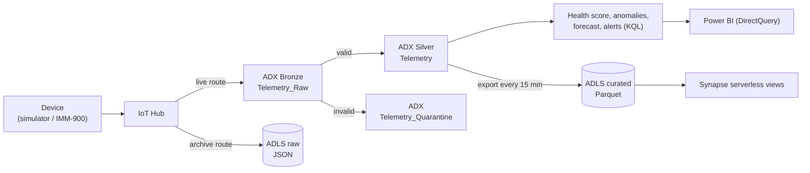
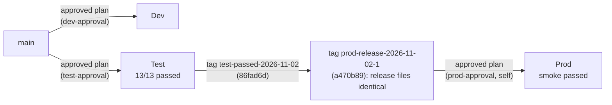

# Husky IoT Predictive Maintenance (Azure)

An Azure data platform for industrial machine telemetry. It takes device readings through IoT Hub, validates them in Azure Data Explorer, scores machine health and maintenance priority in near real time, archives everything to a data lake, and serves history through Synapse serverless SQL and Power BI.

It runs as **three isolated environments: Dev, Test and Prod.** Each has its own resource group, Terraform state, deployment identity and GitHub environment. Infrastructure is defined in Terraform and deployed through saved, reviewed and approved plans. Application code (KQL and SQL) is released by a separate pipeline, and every release proves itself end to end with a real test message.

> **Scope:** a learning and portfolio project, deployed for real on 2026-11-01/02.
> - **Prod approvals are self-approvals:** a recorded human gate, not independent review.
> - **Reconciliation (Bronze = Silver + Quarantine) has not been verified** in any environment.
> - Test is currently **ADX-only**: its Synapse workspace was retired to free the subscription's Synapse quota for Prod.
> - No performance figures are claimed beyond single-run timings.

## Architecture



| Layer | Service | Details |
|---|---|---|
| Ingest | Azure IoT Hub (Dev F1; Test/Prod B1) | every message goes to both ADX and the raw archive |
| Real time | Azure Data Explorer (Dev SKU) | Bronze, then Silver or Quarantine through update policies; 12 validation rules |
| Analytics | KQL functions | health score, vibration anomalies, trend forecast, prioritised maintenance alerts |
| Lake | ADLS Gen2 | `raw` (JSON replay copy), `curated` (Parquet) |
| History | Synapse serverless SQL | deduplicated, daily and fleet views over Parquet |
| Report | Power BI | live report on ADX (Dev) |
| Operate | Azure Monitor | ingestion and export failure alerts by email |

More detail: [architecture](docs/architecture.md) · [data flow](docs/data-flow.md)

## Environments and promotion



| | Dev | Test | Prod |
|---|---|---|---|
| Resource group / state | `rg-husky-pdm-dev` / `tfstate-dev` | `rg-husky-pdm-test` / `tfstate-test` | `rg-husky-pdm-prod` / `tfstate-prod` |
| Deployer (OIDC, per GitHub environment) | `sp-husky-pdm-dev` (Contributor) | `sp-husky-pdm-test` (narrowed custom role) | `sp-husky-pdm-prod` (narrowed custom role) |
| Deploys from | `main` | `main` | **`prod-release-*` tags only** |
| Synapse | Terraform | retired (ADX-only) | **created by the admin**; Terraform only reads it |
| Status | ✅ deployed | ✅ accepted 13/13, then Synapse retired | ✅ deployed, smoke passed, no drift |

Details: [test-environment.md](docs/test-environment.md) · [prod-environment.md](docs/prod-environment.md)

## How it's delivered

| Workflow | Environment | What it does |
|---|---|---|
| [deploy-dev.yml](.github/workflows/deploy-dev.yml) | Dev | no-change gate: fails if Azure doesn't match the code |
| [deploy-dev-approved.yml](.github/workflows/deploy-dev-approved.yml), [deploy-test-approved.yml](.github/workflows/deploy-test-approved.yml), [deploy-prod-approved.yml](.github/workflows/deploy-prod-approved.yml) | Dev / Test / Prod | target guard → OIDC → **isolation proof** → saved plan → guards (no deletes, no admin grants, no self-grants) → SHA-256 and provenance → **required reviewer** → apply the exact plan → **post-apply no-change**. Prod also requires a release tag that contains the tested tag. |
| [deploy-app-dev.yml](.github/workflows/deploy-app-dev.yml), [deploy-app-test.yml](.github/workflows/deploy-app-test.yml), [deploy-app-prod.yml](.github/workflows/deploy-app-prod.yml) | Dev / Test / Prod | deploy KQL and Synapse SQL, **re-run to prove nothing changes**, verify, then send a test message through every layer. Prod first runs a **promotion check** (files identical to the tested tag) and a **preflight** (admin-only prerequisites in place). |

- **State:** Azure Storage with Entra-only access, one container per environment, and each deployer can reach only its own.
- **Deployers:** Test and Prod deployers use a custom role that can't grant ADX or Synapse admin rights, plus a role-grant permission limited to two storage roles and excluding themselves.
- **Admin-only grants** are made by hand and recorded in Git.

More detail: [CI/CD](docs/cicd.md) · [security](docs/security.md)

## Verified results

| Evidence | Result |
|---|---|
| **Prod smoke**: run `41437359315` (tag `prod-release-2026-11-02-1`) | promotion check OK, preflight OK; IMM-900 message → Bronze (340 s) → Silver → raw archive → Parquet → Synapse; views read the lake |
| **Prod no drift**: run `41440910246` | "No changes: approval and apply will be skipped"; isolation from Dev and Test proven |
| Prod infrastructure: runs `41412119364`, `41418285822`, `41432917752` | 20 + 1 + 2 resources through approved exact plans; each followed by "No changes" |
| **Test acceptance**: run `41401561043` (tag `test-passed-2026-11-02`) | **13 of 13 integration tests**, including quarantine of an invalid reading |
| Dev full release: run `41313214638` | 13 of 13 integration tests |
| Negative controls | a broken KQL function and a broken SQL view failed their deploys; a missing view failed its test; the plan guards blocked deletes, admin grants and self-grants in local tests |
| **Not verified** | reconciliation (Bronze = Silver + Quarantine); independent (non-self) approval |

Real problems found and fixed on the way (ADX export permissions, the Synapse creator becoming the only admin, the Synapse quota, the empty-lake export check, a secret damaged by a PowerShell pipe): [prod-environment.md § Problems](docs/prod-environment.md#problems-found-in-the-real-deployments).

## Status

| Area | Status |
|---|---|
| Simulator, contract, IoT Hub, ADX medallion, analytics, export, Synapse, Power BI, monitoring | ✅ Dev |
| Terraform state, OIDC, no-change gate, approved-plan deployment | ✅ Dev, Test, Prod |
| Application release with end-to-end tests | ✅ Dev, Test (13/13), Prod (smoke) |
| Test → Prod promotion of the tested release | ✅ `test-passed-2026-11-02` → `prod-release-2026-11-02-1` |
| Data-health gates: freshness and reconciliation (Lesson 19D) | ❌ **not verified**; draft test kept uncommitted |
| Independent Prod approval | ❌ self-approval only (solo project) |
| Branch protection on `main` | ⬜ not set |
| Failure and recovery drills | ⬜ planned |
| Security hardening (network isolation, key-less ADX connection, manual principals into Terraform) | ⬜ see [known gaps](docs/security.md#known-gaps) |

## Repository layout

```
contracts/       telemetry JSON schema (v1)
simulator/       machine and fault simulation, IoT Hub sender
kql/             ADX tables, validation, update policies, analytics, export
synapse/         serverless SQL: one-time admin bootstrap (00_*, 01, 02) and release views (05)
deploy/          release manifests (order and create-only rules)
scripts/         deploy_kql.py, deploy_synapse.py
infra/bootstrap               Terraform remote-state storage (run once, local state)
infra/bootstrap-env           admin-only per-environment bootstrap (Terraform option)
infra/roles                   Test/Prod deployer custom roles and role-grant conditions
infra/terraform/modules       pdm_platform: shared module used by Test and Prod
infra/terraform/envs/{dev,test,prod}
infra/manual-grants.md        admin-only grants (Dev), recorded
tests/           unit tests; tests/integration runs against live Azure
powerbi/         live report (.pbix)
docs/            architecture, data flow, CI/CD, security, testing, runbooks, test/prod environments
```

## Running it

**Offline (no Azure):**
```powershell
python -m venv .venv; .venv\Scripts\Activate.ps1
pip install azure-identity azure-kusto-data azure-storage-blob azure-iot-device jsonschema pyodbc pytest
python -m pytest tests -q                    # 40 passed
python scripts\deploy_kql.py --dry-run       # needs $env:ADLS_ACCOUNT_NAME
python scripts\deploy_synapse.py --dry-run
```

**Releasing:**
```powershell
az kusto cluster start --name adxhuskypdmdev0599 --resource-group rg-husky-pdm-dev
gh workflow run deploy-app-dev.yml -f scope=full                                  # Dev
gh workflow run deploy-app-test.yml -f scope=kql-only                             # Test (ADX-only now)
gh workflow run deploy-app-prod.yml --ref prod-release-2026-11-02-1 -f scope=smoke # Prod: tag only
gh run watch
az kusto cluster stop  --name adxhuskypdmdev0599 --resource-group rg-husky-pdm-dev
```

**Cost:**
- ADX is billed **only while running** (about $0.126/h per cluster). Keep all three stopped between sessions.
- Test and Prod IoT Hub B1 cost **$10/month each, even when idle**.

Stop, start and clean-up procedures: [runbooks.md §9](docs/runbooks.md#9-cost-control-and-clean-up). When something breaks: [docs/runbooks.md](docs/runbooks.md).
