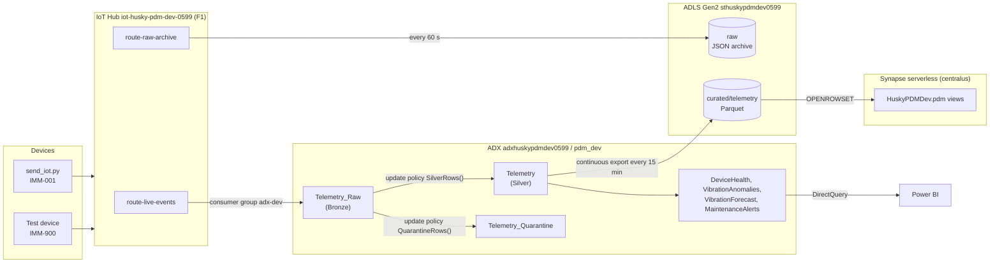

# Architecture

This page describes what is **deployed and running in Dev today**. Test and Prod are designed for (separate state containers exist) but not built; see [Status](#implementation-status).

## Overview

A Python simulator models injection-moulding machines with fault injection. `simulator/send_iot.py` sends one validated JSON reading per run to Azure IoT Hub, as `IMM-001` by default or as the dedicated test device `IMM-900` in the release pipeline. The 12-machine fleet simulator (`simulator/run_fleet.py`) writes local JSONL files only; it does not send to IoT Hub.

IoT Hub sends every message two ways:

1. **Live path** to Azure Data Explorer (ADX), where it is validated into Silver or Quarantine within minutes and scored by predictive-maintenance functions.
2. **Archive path** to the `raw` container in ADLS Gen2, an untouched copy that can be replayed.

ADX continuously exports Silver to Parquet in the `curated` container. Synapse serverless SQL reads that Parquet through views for historical reporting. Power BI connects to ADX for the live view.

The full message lifecycle, including validation rules and timings, is in [data-flow.md](data-flow.md).

## Components

All Dev resources are in resource group `rg-husky-pdm-dev` (`eastus2`), except Synapse.

| Component | Resource | Configuration | Defined in |
|---|---|---|---|
| Device ingestion | IoT Hub `iot-husky-pdm-dev-0599` | F1 (free) tier, 2 partitions, system-assigned identity | [`main.tf`](../infra/terraform/envs/dev/main.tf) |
| Routing | `route-live-events`, `route-raw-archive` | both `condition = "true"`: every message goes to both | [`routing.tf`](../infra/terraform/envs/dev/routing.tf) |
| Raw archive | container `raw` | JSON, 60 s batches, path `{iothub}/{partition}/{YYYY}/{MM}/{DD}/{HH}/{mm}`, identity-based write | [`routing.tf`](../infra/terraform/envs/dev/routing.tf) |
| Real-time store | ADX `adxhuskypdmdev0599` | `Dev(No SLA)_Standard_E2a_v4`, 1 instance, system-assigned identity | [`adx.tf`](../infra/terraform/envs/dev/adx.tf) |
| Database | `pdm_dev` | hot cache 1 day, soft delete 7 days, `prevent_destroy` | [`adx.tf`](../infra/terraform/envs/dev/adx.tf) |
| ADX ingestion | data connection `iot-telemetry-dev` | consumer group `adx-dev`, table `Telemetry_Raw`, mapping `TelemetryRawMapping`, adds `iothub-connection-device-id` | [`adx.tf`](../infra/terraform/envs/dev/adx.tf) |
| Tables, functions, policies, export | KQL scripts | deployed by the release pipeline, not Terraform | [`kql/`](../kql), [`deploy/kql-manifest.txt`](../deploy/kql-manifest.txt) |
| Data lake | Storage `sthuskypdmdev0599` | ADLS Gen2 (HNS), TLS 1.2, no public blobs; containers `raw`, `curated`, `quarantine`, `synapse` | [`main.tf`](../infra/terraform/envs/dev/main.tf) |
| Historical SQL | Synapse `syn-husky-pdm-dev-0599`, serverless database `HuskyPDMDev` | `centralus` (SQL provisioning in `eastus2` was restricted for this subscription); Entra-only authentication | [`synapse.tf`](../infra/terraform/envs/dev/synapse.tf), [`synapse/`](../synapse) |
| Monitoring | Log Analytics `law-husky-pdm-dev`, action group `ag-husky-pdm-dev`, 2 metric alerts | 30-day retention, 0.1 GB/day cap | [`monitor.tf`](../infra/terraform/envs/dev/monitor.tf) |
| Live report | `powerbi/Husky_PDM_Live.pbix` | DirectQuery to ADX | [`powerbi/`](../powerbi) |
| Terraform state | `rg-husky-pdm-tfstate` / `sthpdm5mljzdg5` | containers `tfstate-dev`, `tfstate-test`, `tfstate-prod`; versioning, 7-day soft delete, shared keys disabled | [`infra/bootstrap/main.tf`](../infra/bootstrap/main.tf) |

The `quarantine` storage container exists, but nothing in this repository writes to it. Rejected rows live in the ADX table `Telemetry_Quarantine`.

## Design decisions

| Decision | Why | Trade-off |
|---|---|---|
| Two IoT Hub routes (live + archive) | ADX gives minutes-fresh analytics. The raw JSON archive is an independent replay source if ADX data is lost or a validation bug is found. | Storage cost for a second copy (small at this volume). |
| Bronze / Silver / Quarantine inside ADX | Validation runs as update policies at ingestion time, so bad rows never reach Silver. Rejected rows keep the original payload plus a `RejectReason`. | Validation logic lives in KQL, so it is duplicated from the Python JSON-schema check in the simulator ([`contracts/telemetry_v1.schema.json`](../contracts/telemetry_v1.schema.json)). |
| Update policies are **non-transactional** (`IsTransactional: false`) | A failing policy never blocks raw ingestion, so Bronze is never lost. | A failing policy can silently drop rows downstream. A reconciliation gate was designed for this (Lesson 19D) but skipped; see [testing.md](testing.md#lesson-19d-skipped). |
| Deduplicate at read time (`TelemetryDeduplicated()`, `vw_telemetry_deduplicated`) | IoT Hub delivery is at-least-once. Keeping duplicates in storage and removing them in queries keeps ingestion simple. | Every query pays the dedup cost. |
| Continuous export to Parquet every 15 min | Cheap, open-format history that Synapse (or any engine) can read without ADX running. | Synapse data is up to ~15 min behind ADX. |
| Synapse serverless, not a dedicated pool | Pay per TB scanned, nothing to stop or start. | Cold-start latency; occasional "warming up" errors handled by a retry in the test helper. |
| ADX Dev SKU, stopped between sessions | Lowest-cost ADX option for a lab. | No SLA. Every workflow checks that ADX is `Running` first and fails clearly if it is not. |
| KQL objects owned by the release pipeline, not Terraform | Terraform manages the cluster and permissions. Application logic changes far more often and needs its own deploy, re-run and verify steps. | Two tools. The handover used `removed { destroy = false }` blocks so nothing was deleted; see [cicd.md](cicd.md#kql-ownership-handover). |

## Implementation status

| Area | Status |
|---|---|
| Simulator, telemetry contract, IoT Hub, dual routing | Implemented (Dev) |
| ADX Bronze / Silver / Quarantine, predictive-maintenance functions | Implemented (Dev) |
| Parquet export, Synapse views, Power BI live report | Implemented (Dev) |
| Azure Monitor diagnostics and alerts | Implemented (Dev) |
| Terraform remote state, OIDC, no-change gate, approved-plan apply | Implemented (Dev, Test, Prod) |
| Application release pipeline with end-to-end tests (Lessons 19A–19C) | Implemented and proven: Dev and Test 13/13, Prod smoke test |
| Data-health gates: freshness and reconciliation (Lesson 19D) | **Not verified** in any environment. Draft test file kept uncommitted. |
| Test and Prod environments, promotion (Lesson 18C) | **Deployed 2026-11-01/02.** Test accepted, then its Synapse was retired (ADX-only). Prod promoted from `test-passed-2026-11-02` via `prod-release-2026-11-02-1`. See [test-environment.md](test-environment.md) and [prod-environment.md](prod-environment.md). |
| Failure drills | **Not started** (planned next) |
| Security hardening (network restriction, key-less ADX connection, `pbi-analyst` in Terraform) | **Not started**; see [security.md](security.md#known-gaps) |
