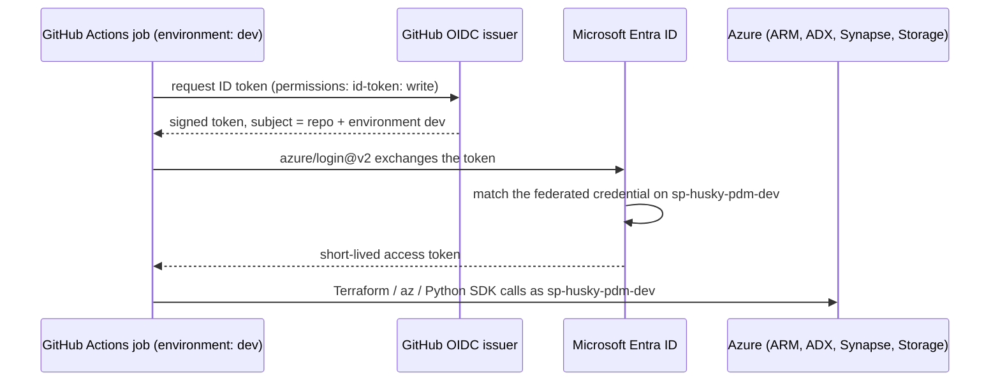
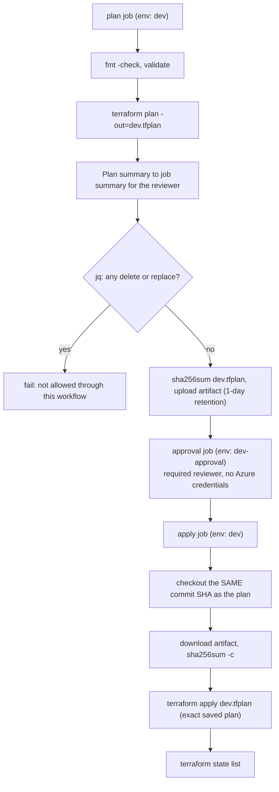

# CI/CD

Infrastructure and application code are deployed separately, by three GitHub Actions workflows. All three are started manually (`workflow_dispatch`); **nothing deploys automatically on push**. All of them run in the GitHub environment `dev` and authenticate to Azure with OIDC.

| Workflow | File | Purpose |
|---|---|---|
| Deploy Husky DEV | [`deploy-dev.yml`](../.github/workflows/deploy-dev.yml) | **Read-only no-change gate.** Fails if Terraform would change anything. Never applies. |
| Husky DEV - Approved Terraform Deployment | [`deploy-dev-approved.yml`](../.github/workflows/deploy-dev-approved.yml) | Plan, then human approval, then apply **exactly** that plan. |
| Husky DEV - Application Deployment | [`deploy-app-dev.yml`](../.github/workflows/deploy-app-dev.yml) | Releases KQL and Synapse SQL, re-runs to prove idempotency, and runs integration tests. |

The two Terraform workflows share the concurrency group `husky-terraform-dev`, so they can never touch Dev state at the same time. The application workflow uses `husky-app-dev`.

## Authentication: OIDC, no stored Azure secret

- **App registration / service principal:** `sp-husky-pdm-dev`. Its client, tenant and subscription IDs are environment **variables**, not secrets, because they are identifiers rather than credentials.
- **Federated credential `gh-husky-dev-env`:**
  - issuer: `https://token.actions.githubusercontent.com`
  - subject: `repo:santnair0599@31506535/husky-iot-pdm-practice@1427372824:environment:dev`

  The subject uses GitHub's immutable owner and repository IDs, so renaming the repository or account can't make another repository match. Only jobs that declare `environment: dev` get a token Entra accepts.
- **`dev` environment protection:** deployments are limited to the `main` branch by a custom branch policy.
- Terraform uses the same token through `ARM_USE_OIDC=true`. The approved workflow also sets `ARM_USE_CLI=false`, so Terraform cannot silently fall back to another login.

## Terraform

### Remote state

| Setting | Value |
|---|---|
| Backend | `azurerm` with `use_azuread_auth = true` ([`backend.tf`](../infra/terraform/envs/dev/backend.tf)) |
| Account | `sthpdm5mljzdg5` in `rg-husky-pdm-tfstate`, created by [`infra/bootstrap`](../infra/bootstrap/main.tf) (local state, run once) |
| Container / key | `tfstate-dev` / `husky-dev.tfstate` (passed with `-backend-config` at init) |
| Protection | blob versioning, 7-day blob and container soft delete, **shared-key access disabled** (Entra auth only), TLS 1.2 |
| Locking | Azure blob lease; every plan and apply uses `-lock-timeout=5m` |

The deployer has `Storage Blob Data Contributor` on the `tfstate-dev` **container** only, not on the account and not on `tfstate-test` or `tfstate-prod`.

`terraform.tfvars` is git-ignored. CI gets the same values from `dev` environment variables (`TF_VAR_*`), plus the secret `ALERT_EMAIL`. Terraform is pinned to `1.15.5`, the version that last wrote the state.

### No-change gate (`deploy-dev.yml`)

Runs `terraform plan -detailed-exitcode` and reads the exit code:

| Exit code | Meaning | Workflow result |
|---|---|---|
| 0 | no changes | pass: "No infrastructure changes detected." |
| 1 | plan error | fail |
| 2 | changes detected | fail, and print the plan |

Use it to prove that Azure still matches the code: after every apply, and whenever you suspect drift.

### Approved deployment (`deploy-dev-approved.yml`)

Controls, and what each one prevents:
- **Saved plan plus checksum.** The reviewer approves what is actually applied, and an edited plan file fails the checksum.
- **Apply checks out the plan's commit SHA.** A commit pushed after approval can't sneak in.
- **The `jq` guard blocks any `delete` action.** That includes replacements, which are delete-then-create. Destroying a resource needs a deliberate, separate process.
- **The approval job runs in `dev-approval`.** That environment has a required reviewer but no OIDC trust, so the approval step itself can't touch Azure.
- **Every job first checks that ADX is `Running`.** If not, it fails with a clear message instead of a confusing provider error.

### KQL ownership handover

Until Lesson 19, KQL ran through `azurerm_kusto_script` resources. In commit `5e5a265` those were replaced by five `removed { lifecycle { destroy = false } }` blocks in [`adx.tf`](../infra/terraform/envs/dev/adx.tf). That makes Terraform **forget** the scripts without running or deleting anything in the database. The release pipeline is now the only owner of tables, functions, policies and exports, so each object has exactly one owner.

## Application release (`deploy-app-dev.yml`)

Input `scope` picks how much runs:

| Step | `kql-only` (default) | `kql-sql` | `full` |
|---|---|---|---|
| Unit tests (offline), dry-run render of KQL and SQL | ✓ | ✓ | ✓ |
| Install ODBC Driver 18 | | ✓ | ✓ |
| OIDC login, check ADX running | ✓ | ✓ | ✓ |
| Deploy KQL → **re-run (must change nothing)** → verify KQL objects | ✓ | ✓ | ✓ |
| Deploy Synapse views → **re-run** → verify views | | ✓ | ✓ |
| Send test telemetry as IMM-900, validate message ID | | | ✓ |
| Verify Bronze/Silver, quarantine, raw archive | | | ✓ |
| Refresh login, verify Synapse historical export | | | ✓ |
| Release summary | always | always | always |

### KQL deployment ([`scripts/deploy_kql.py`](../scripts/deploy_kql.py))

- Reads files in the order listed in [`deploy/kql-manifest.txt`](../deploy/kql-manifest.txt): tables, then functions, update policies, analytics and the lake export.
- **Renders every file before deploying any of them**, so a bad file or a missing placeholder stops the release before anything changes.
- Only one placeholder is allowed, `{{ADLS_ACCOUNT_NAME}}`, and its value must match `^[a-z0-9]{3,24}$`.
- Each file is sent as one `.execute database script with (ThrowOnErrors=true)`. Any command that doesn't report `Completed` fails the release.
- **Create-only entries** (the external table and the continuous export) are skipped if they already exist.
- Uses `.create-merge` / `.create-or-alter`, so it is safe to re-run. The workflow proves this by running it twice.
- **Not transactional across commands.** Commands before a failure stay applied. Recovery is "fix and re-run"; see [runbooks.md](runbooks.md#5-a-release-fails-halfway).

### Synapse deployment ([`scripts/deploy_synapse.py`](../scripts/deploy_synapse.py))

- Reads files listed in [`deploy/synapse-manifest.txt`](../deploy/synapse-manifest.txt). Currently that's only `05_deploy_views.sql`.
- Splits files on `GO` lines and runs each batch in order. `CREATE OR ALTER` makes re-runs safe.
- Signs in with an Entra access token over ODBC 18 (or 17). There is no SQL password.
- **Refuses any file containing `PASSWORD`, `MASTER KEY` or `SECRET`.** Privileged bootstrap SQL ([`01_database.sql`](../synapse/01_database.sql), [`02_external_source.sql`](../synapse/02_external_source.sql), [`00_grant_deployer.sql`](../synapse/00_grant_deployer.sql)) can't end up in a release.

## Verified runs

| Run ID | Date | Commit | Workflow | Evidence |
|---|---|---|---|---|
| `40516178422` | 2026-10-27 | `3f99db8` | no-change gate | "No changes", "No infrastructure changes detected." (Lesson 18B) |
| `40678983606` | 2026-10-28 | `2468212` | approved deployment | first run of the workflow: plan "No changes", approval gate passed, `dev.tfplan: OK` (18C Dev) |
| `40680272107` | 2026-10-28 | `d24b0ca` | approved deployment | plan **0 to add, 1 to change, 0 to destroy** (the `release_test` tag), approved, `dev.tfplan: OK`, applied (18C Dev) |
| `41287480751` | 2026-11-01 | `5e5a265` | approved deployment | approval recorded, `dev.tfplan: OK`, **1 added, 0 changed, 0 destroyed** (deployer ADX database admin) |
| `41287867245` | 2026-11-01 | `5e5a265` | no-change gate | "No changes" right after that apply |
| `41291855425` | 2026-11-01 | `700743d` | app release, `kql-only` | deploy, re-run and verify KQL passed |
| `41310902846` | 2026-11-01 | `9ee29c7` | app release, `kql-sql` | 3 SQL batches completed twice; views `2 passed`; ran as `sp-husky-pdm-dev` |
| `41313214638` | 2026-11-01 | `fe52f1b` | app release, `full` | all 13 integration tests passed; see [testing.md](testing.md#end-to-end-evidence) |

## Not implemented

- Test and Prod workflows, promotion between environments, and rollback tags (Lesson 18C Test/Prod).
- Automatic triggers (on push or pull request) and a pull-request CI workflow.
- Node 24 versions of `actions/checkout`, `actions/setup-python` and `azure/login`. Runs currently show a deprecation notice, and GitHub forces Node 24 at runtime.
