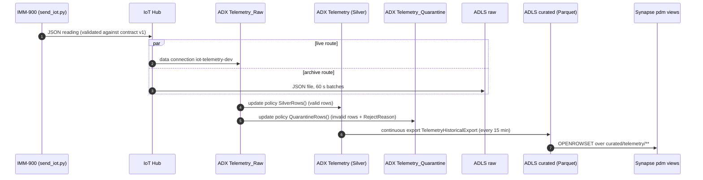

# Data flow: the life of one message

This follows one real message through Dev: the one sent by GitHub Actions run `41313214638` on 2026-11-01, message ID `08600bc9-8f8c-472d-8627-9170ffb3e98b`, from the test device `IMM-900`. Each stage lists the code that implements it and the test that proved it.

## 1. Produce: contract-checked JSON

[`simulator/send_iot.py`](../simulator/send_iot.py) builds one reading with [`simulator/machine.py`](../simulator/machine.py) and checks it against [`contracts/telemetry_v1.schema.json`](../contracts/telemetry_v1.schema.json) before sending. An invalid reading is never sent. The message's IoT Hub `message_id` is set to the reading's own UUID.

| Field | Rule (contract v1) |
|---|---|
| `schema_version` | exactly `"1.0"` |
| `message_id` | UUID |
| `machine_id` | `IMM-` + 3 digits |
| `event_time` | ISO date-time ending in `Z` or `+00:00` |
| `temperature_c` | -20 to 250 |
| `vibration_mm_s` | 0 to 100 |
| `pressure_bar` | 0 to 500 |
| `cycle_time_s` | above 0, up to 300 |
| `running_hours` | 0 or more |
| `status` | `RUNNING`, `IDLE` or `STOPPED` |

The device authenticates with its own IoT Hub device key. In the pipeline, the key comes from the GitHub secret `IOTHUB_DEVICE_CONNECTION_STRING`; see [security.md](security.md#secrets-and-configuration).

## 2. Route: IoT Hub sends every message twice

Both routes in [`routing.tf`](../infra/terraform/envs/dev/routing.tf) use `condition = "true"`.

- **`route-live-events`** goes to the built-in `events` endpoint. ADX reads it through consumer group `adx-dev`.
- **`route-raw-archive`** writes JSON files to the `raw` container every 60 seconds (or 10 MB), using the IoT Hub's managed identity. Files land at `iot-husky-pdm-dev-0599/{partition}/{YYYY}/{MM}/{DD}/{HH}/{mm}`. The test message was found in `iot-husky-pdm-dev-0599/01/2026/11/01/13/52`.

## 3. Bronze: `Telemetry_Raw`

The ADX data connection ([`adx.tf`](../infra/terraform/envs/dev/adx.tf)) ingests each message into `Telemetry_Raw` ([`kql/01_raw_ingestion.kql`](../kql/01_raw_ingestion.kql)). It has two columns:
- `Payload` (dynamic): the whole JSON body, unchanged
- `IoTHubDeviceId`: the identity IoT Hub **authenticated**, taken from the system property `iothub-connection-device-id`, not from the payload

ADX ingests in batches. In run `41313214638` the Bronze and Silver checks passed 325 seconds after sending. That's one observation, not a measured SLA. The test allows 600 seconds.

## 4. Validate: Silver or Quarantine

Two update policies ([`kql/04_update_policies.kql`](../kql/04_update_policies.kql)) run on every Bronze ingestion. Both call `ValidateTelemetryRows()` ([`kql/03_validation_functions.kql`](../kql/03_validation_functions.kql)), which gives each row a `RejectReason`, or an empty string if the row is valid.

- **`SilverRows()`** sends valid rows to `Telemetry`, as typed columns.
- **`QuarantineRows()`** sends invalid rows to `Telemetry_Quarantine`, with the original `Payload` and the `RejectReason`.

The checks are applied in order, and the first failure wins:

| Order | RejectReason | Rule |
|---|---|---|
| 1 | `INVALID_SCHEMA_VERSION` | `schema_version` is not `1.0` |
| 2 | `INVALID_MESSAGE_ID` | not a UUID |
| 3 | `INVALID_MACHINE_ID` | not `IMM-###` |
| 4 | `MISSING_AUTHENTICATED_DEVICE_ID` | no IoT Hub device identity |
| 5 | `DEVICE_ID_MISMATCH` | payload `machine_id` differs from the authenticated device: **one device cannot report as another** |
| 6 | `INVALID_EVENT_TIME` | not parseable, or not UTC |
| 7–11 | `INVALID_TEMPERATURE`, `INVALID_VIBRATION`, `INVALID_PRESSURE`, `INVALID_CYCLE_TIME`, `INVALID_RUNNING_HOURS` | wrong type or out of range (same ranges as the contract) |
| 12 | `INVALID_STATUS` | not `RUNNING`/`IDLE`/`STOPPED` |

Both policies are **non-transactional**. A failure in either policy does not undo the Bronze ingestion, so raw data is never lost. But a broken policy can silently drop rows from Silver or Quarantine. See [runbooks.md](runbooks.md#3-rows-in-bronze-but-missing-from-silver-or-quarantine).

## 5. Analyse: predictive-maintenance functions

All analytics read `TelemetryDeduplicated()`, which keeps one row per `MessageId`. IoT Hub delivery is at-least-once, so duplicates are possible.

| Function | File | What it returns |
|---|---|---|
| `DeviceHealth()` | [`06_device_health.kql`](../kql/06_device_health.kql) | latest reading per machine (last 24 h), a 0–100 health score built from weighted vibration (40%), temperature (35%) and pressure (25%) penalties, and `HEALTHY`/`WARNING`/`CRITICAL` |
| `VibrationAnomalies()` | [`07_vibration_anomalies.kql`](../kql/07_vibration_anomalies.kql) | readings flagged `CRITICAL_VIBRATION` (≥ 8 mm/s), `SUDDEN_VIBRATION_SPIKE` (jump ≥ 5), `OVERHEATING` (≥ 100 °C) or `CRITICAL_PRESSURE_DROP` (< 110 bar) |
| `VibrationForecast()` | [`08_vibration_forecast.kql`](../kql/08_vibration_forecast.kql) | linear trend of 5-minute vibration over the last 2 h and estimated hours until 8 mm/s; needs at least 6 observed bins and R² ≥ 0.70, otherwise no estimate |
| `MaintenanceAlerts()` | [`09_maintenance_alerts.kql`](../kql/09_maintenance_alerts.kql) | priority `P1_CRITICAL`/`P2_HIGH`/`P3_MONITOR` and a recommended action per machine |

The Power BI report in [`powerbi/`](../powerbi) queries ADX directly (DirectQuery), so it shows these results live.

## 6. Export: Parquet in the lake

The continuous export `TelemetryHistoricalExport` ([`kql/12_continuous_export.kql`](../kql/12_continuous_export.kql)) writes new Silver rows every 15 minutes. It writes to the external table `TelemetryParquet` ([`kql/11_external_parquet.kql`](../kql/11_external_parquet.kql)), which points at `curated/telemetry`. It authenticates with the ADX cluster's managed identity, which has `Storage Blob Data Contributor` on `curated` ([`adx_export.tf`](../infra/terraform/envs/dev/adx_export.tf)).

Only Silver is exported. Quarantine stays in ADX.

Both files are **create-only** in the release manifest. They are deployed once and then skipped, so a routine release never re-creates a live export and resets its progress.

## 7. Report: Synapse serverless views

[`synapse/05_deploy_views.sql`](../synapse/05_deploy_views.sql) defines three views in `HuskyPDMDev.pdm`:

| View | Reads | Purpose |
|---|---|---|
| `vw_telemetry_deduplicated` | Parquet via `OPENROWSET(BULK 'telemetry/**', DATA_SOURCE = 'HuskyCuratedLake')` | one row per `MessageId` |
| `vw_device_daily` | the view above | per machine per day: counts, averages, maxima, critical readings |
| `vw_fleet_summary` | `vw_device_daily` | per day: active machines and fleet totals |

The data source `HuskyCuratedLake` uses the credential `HuskyLakeIdentity`, which is the Synapse workspace's managed identity. That identity has `Storage Blob Data Reader` on `curated`. These objects are a one-time bootstrap ([`synapse/02_external_source.sql`](../synapse/02_external_source.sql)) and are not part of the release.

In run `41313214638` the test message was visible in `vw_telemetry_deduplicated` 63 seconds after the Synapse check started. That time depends on where the 15-minute export cycle happened to be, so the test allows up to 30 minutes.

## Retention

| Store | Retention |
|---|---|
| ADX `pdm_dev` | soft delete 7 days, hot cache 1 day |
| `raw`, `curated` containers | no lifecycle policy (kept until deleted) |
| Log Analytics | 30 days |
